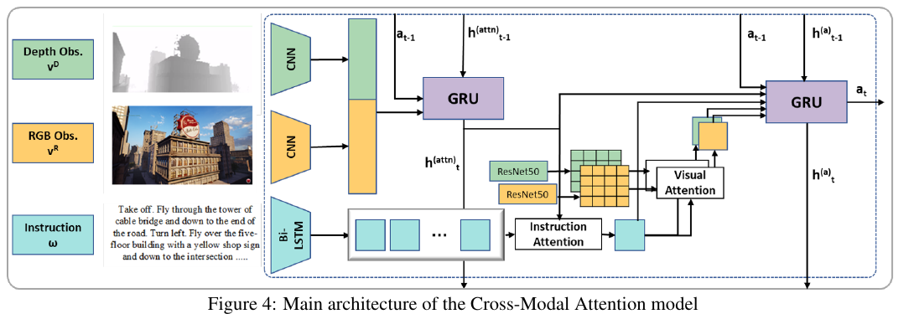

# AerialVLN

> 完整英文标题：AerialVLN: Vision-and-Language Navigation for UAVs
>

> 作者：Shubo Liu、Hongsheng Zhang、Yuankai Qi、Peng Wang、Yanning Zhang、Qi Wu；前两位为共同第一作者。
>
> 发表年份 / 版本：2023，arXiv:2308.06735v1，2023-08-13。本笔记以提供的 11 页 PDF 为准，不混用后续版本结果。
>
> 原文：[arXiv v1](https://arxiv.org/abs/2308.06735v1)；论文所列代码与数据入口：[AirVLN/AirVLN](https://github.com/AirVLN/AirVLN)。本次未核查或运行代码。
>
> 阅读日期：2026-11-03
>
> 阅读深度：精读（正文及图表；未复现，未阅读独立补充材料）
>
> 主题标签：空中视觉语言导航、无人机、连续环境、跨模态对齐、模仿学习

## 一句话总结

AerialVLN 将视觉语言导航扩展到城市级三维无人机飞行，建立 25 个场景、8,446 条航线与 25,338 条语言指令的仿真基准，并提出沿参考路线向前寻找监督目标的 Look-ahead Guidance（LAG）；低成功率表明，长程路线跟随、三维视觉语言对齐和正确停止仍然困难。

## 问题与背景

地面 VLN 通常研究室内或街景导航。飞行进一步引入高度变化、水平侧移、建筑遮挡与三维障碍物，同时路线更长、需要持续跟踪多个地标。已有小型空中导航设置不足以覆盖这些问题。

本论文的主要贡献是**任务定义、仿真环境和数据集**，同时提供模型及训练监督基线。阅读时应区分“建立困难基准”与“解决该基准”。

### 任务设定

根据第 3、4 节：智能体从给定初始位姿出发，接收一条自然语言指令，逐步根据第一人称观测预测动作，直到输出 Stop 或达到最大步数。

| 项目 | 设置 |
| --- | --- |
| 环境 | Unreal Engine 4 + AirSim；无预建导航图，未被物体占据的位置可导航。 |
| 基线观测 | 前视 RGB 与深度图；深度感知范围 100 米，观察其他方向需要转向。 |
| 自由度 | 动作覆盖位置 x、y、z 与偏航角，共 4 DoF；记录的位姿包含 6 DoF，不代表基线可控制全部六个自由度。 |
| 水平移动 | 前进、左移、右移，每次 5 米。 |
| 转向 | 左转或右转，每次 15 度。 |
| 垂直移动 | 上升或下降，每次 2 米。 |
| 停止 | Stop；共八种动作。 |
| 成功条件 | 停止位置到目标的距离小于 20 米。 |

“连续环境”表示智能体不局限于预定义导航图；**基线动作选择仍是离散的**。模拟器支持更多观测、天气和光照设置，但不能据此认为基线使用了这些信息，或已证明相应鲁棒性。

## 核心方法

### 1. 数据采集与标注

第 5 节描述的流程是：具有 AOPA 资质的飞手在模拟器中驾驶无人机经过指定地标，生成轨迹；移除冗余运动后离散为基础动作；AMT 标注者观看飞行视频，每条航线由不同标注者给出三份指令，再由另一组人员检查。

完整数据集覆盖城市中心、工厂、公园和村落等 25 个场景、870 余种物体。平均路线长 **661.8 米**，约 **204 个动作**；指令平均 **83 个词**，词汇量为 **4,470**。作者还说明提供子路径与子指令对齐，支持细粒度学习。

小场景子集 **AerialVLN-S** 包含 17 个场景、3,916 条路线和 11,748 条指令，平均路线长 321.3 米、约 115 个动作。它不是完整集的同难度替代：部分起点甚至能够观察到目标。

### 2. Seq2Seq 与跨模态注意力 CMA

- **Seq2Seq**：编码 RGB、深度和整条指令，将特征输入 GRU，通过循环隐藏状态预测动作。
- **CMA（Cross-Modal Attention）**：用 BiLSTM 编码指令；循环状态跟踪观测和上一动作，再对当前相关的指令片段进行注意力选择；根据该语言表示选择 RGB、深度中的相关信息，最后由决策 GRU 输出动作。

直觉上，CMA 不仅需要知道“看见什么”，还需要跟踪“现在执行到哪句话”，再寻找对应地标。

图源：原论文 Figure 4，PDF 第 6 页。图中为 CMA 基线；LAG 在此基础上改变训练监督目标。

### 3. Look-ahead Guidance（LAG）

**问题**：student-forcing 训练让模型执行自己预测的动作，可能偏离示范轨迹。如果此时用“到最终终点的最短路”生成监督，可能跳过指令要求经过的地标，造成语言与动作监督不一致。

第 6.2.1 节与 Figure 5 的做法：

1. 当前处于偏离位置 X，寻找返回参考轨迹的最短路径，其接入点记为 B。
2. 从 B 沿参考轨迹向前推进 **10 步**，得到前瞻目标 C。
3. 计算 X 到 C 的最短路径，取第一个动作作为当前位置的监督动作。

“先回轨迹、再向前走”用于确定 C；实际监督来自 **X 到 C** 的路径，不必先执行 X 到 B。作者将此策略与 CMA 结合，记为 LAG。

我的理解：LAG 约束训练时的局部恢复方向，使其仍围绕指令路线前进。它没有直接解决全部长程记忆问题，也不表示推理时可以查询真实路线。

## 实验与证据

### 数据划分

以下为 Table 3 的完整集划分；同一环境可用于多个划分，不能把场景列直接相加。

| 划分 | 场景数 | 路线数 | 指令数 |
| --- | --- | --- | --- |
| Train | 17 | 5,460 | 16,380 |
| Val Seen | 17 | 606 | 1,818 |
| Val Unseen | 8 | 770 | 2,310 |
| Test Unseen | 8 | 1,610 | 4,830 |

Seen 指训练阶段见过的环境；Unseen 用于考察未见环境泛化。论文说明测试目标位置不公开，以评估服务器评分；本次未验证服务器当前状态。

### 指标

| 指标 | 含义 | 方向 |
| --- | --- | --- |
| NE | 最终停止位置与目标的距离，单位为米。 | 越低越好 |
| SR | 停止在目标 20 米范围内的比例。 | 越高越好 |
| OSR | 轨迹上曾有位置进入目标 20 米范围内的比例，无须在那里停止。 | 越高越好 |
| SDTW | 成功率加权的归一化动态时间规整，兼顾成功与参考路线相似性。 | 越高越好 |

下面 SR、OSR、SDTW 均按原表的百分数表示。不能只依据 NE 或 SR 判断是否忠实执行了沿途指令。

### 完整集：传统基线与人类差距大

原论文 Table 4 上半部分，**AerialVLN / Test Unseen**：

| 模型 | NE（米） | SR（%） | OSR（%） | SDTW（%） |
| --- | --- | --- | --- | --- |
| Random | 356.3 | 0.0 | 0.0 | 0.0 |
| Action Sampling | 441.9 | 0.2 | 1.8 | 0.1 |
| Seq2Seq | 558.8 | 1.0 | 4.9 | 0.3 |
| CMA | 358.6 | 1.6 | 4.1 | 0.5 |
| Human | 73.5 | 80.8 | 80.8 | 14.2 |

这些基线在该设置下远未达到人类水平。Human 的 SR 很高但 SDTW 明显更低，也提醒我们：达到目标与复现参考路线是不同的评价维度。不能将这组结果推广成所有后续方法的能力上限。

### 小场景子集：DA 与 LAG 的作用

原论文 Table 4 下半部分，**AerialVLN-S**。DA 指 Dataset Aggregation，通过收集模型实际执行动作产生的状态，缓解训练与测试状态分布不一致。

| 模型 | Val Unseen SR（%） | Val Unseen SDTW（%） | Test Unseen SR（%） | Test Unseen SDTW（%） |
| --- | --- | --- | --- | --- |
| Seq2Seq | 2.3 | 0.7 | 2.2 | 0.7 |
| CMA | 3.2 | 1.1 | 3.9 | 1.4 |
| Seq2Seq-DA | 4.0 | 0.7 | 3.5 | 0.6 |
| CMA-DA | 4.5 | 1.0 | 4.3 | 1.2 |
| LAG | 5.1 | 1.4 | 4.5 | 1.3 |

LAG 相对 CMA-DA 在未见验证集的 SR 提升 **0.6 个百分点**，未见测试集提升 **0.2 个百分点**，SDTW 也有小幅提升。但它**并非所有指标都优于普通 CMA**：测试集 SDTW 为 1.3，低于普通 CMA 的 1.4；已见验证集 SR 为 7.2%，也低于 CMA-DA 的 9.9%。

更准确的结论是“相对 DA 基线，LAG 在小场景未见环境的部分指标上有改善”。原表没有给出完整集上的 LAG 结果，不能将这里的 4.5% 与完整集 CMA 的 1.6% 直接比较。

### 模态消融与失败分析

Table 5 的 Validation Unseen 结果如下；完整输入一行与 Table 4 的 AerialVLN-S / CMA-DA 对应，不应当作完整集结果。

| 输入 | SR（%） | OSR（%） |
| --- | --- | --- |
| RGB + 深度 + 指令 | 4.5 | 13.9 |
| RGB + 指令 | 3.2 | 7.9 |
| 深度 + 指令 | 3.0 | 18.1 |
| 仅指令 | 1.3 | 12.1 |
| RGB + 深度，无指令 | 2.1 | 11.1 |

去掉视觉或语言都会降低 SR；RGB 和深度均有贡献。但消融不足以证明数据“没有偏差”，且仅深度输入的 OSR 更高，也说明指标之间可能存在取舍。

作者还报告：长路径组平均 813.2 米、SR 为 1.8%；短路径组平均 326.9 米、SR 为 7.4%（第 6.2.2 节）。这支持长程任务更困难的观察，但该处未清楚标出具体模型和完整评估条件，不宜视为独立控制变量的严格消融。较大的 OSR 与 SR 差距，提示“经过目标却未正确停止”是失败来源之一。

## 我的理解与评价

### 最有价值的贡献

1. 将长程语言路线、三维行动和城市级场景结合，揭示地面 VLN 基线迁移到空中的困难。
2. 同时提供完整集与小场景子集，便于分别研究长程行为和较基础的空中导航。
3. LAG 强调监督动作必须服务于指令路线，为偏航后构造模仿目标提供了直观方案。

### 适用条件与局限

- **仿真边界**：没有展示真实无人机部署实验；支持动态天气、光照与交通，不等于已经验证跨这些条件的泛化或 sim-to-real 效果。
- **动作与阈值**：5 米水平步长与 20 米成功范围适合基准研究，不能直接解释为精确降落能力；低 NE 也不等于飞行安全。
- **统计可信度**：LAG 部分提升较小，当前 PDF 未报告多随机种子方差或置信区间，需要复现判断稳定性。
- **语言样本**：Table 2 的语言现象统计只抽样 25 条指令，不宜直接代表整个数据集的精确比例。
- **复现细节**：正文对训练超参数、专家动作生成和碰撞处理等信息不足，应查阅代码及补充材料，不能自行补写为已知事实。

我的判断：这篇论文适合作为空中 VLN 的任务与数据基准起点。后续值得研究如何维持语言进度、恢复偏航并判断停止，而不仅是更换视觉编码器。

## 与其他论文的联系

以下依据本论文的相关工作与参考文献整理，相关论文尚未在本项目中独立精读：

| 相关工作 | 与 AerialVLN 的联系 |
| --- | --- |
| R2R / RxR | 提供地面 VLN 的任务与语言背景；本文增加空中行动和更长路线。 |
| VLN-CE（Beyond the Nav-Graph，2020） | 同样研究无预建导航图的连续环境；本文转向室外三维飞行。 |
| LANI | 较早的语言条件空中导航；本文将其 LingUNet 改为逐步决策基线。 |
| ANDH（Aerial Vision-and-Dialog Navigation，2022） | 研究空中视觉对话导航；本文强调第一人称视觉、路线指令和可交互环境。 |
| LAW（Language-Aligned Waypoint Supervision，2021） | 语言对齐路点监督为 LAG 提供启发：恢复动作应考虑参考路线。 |

主题入口：[空中视觉语言导航](../../topics/aerial-vision-language-navigation.md)。

后续对照：[OpenFly](../2026-openfly/index.md) 将采集流程转向多引擎自动化，并研究地标关键帧记忆。两篇论文的路线长度、动作空间和指标不同，原论文成功率不可直接比较；详细对照见主题页。

## 后续行动

- [ ] 核对官方实现中的 LAG 前瞻目标选择、最短路专家和障碍物处理。
- [ ] 查阅训练超参数、最大动作数、随机种子与碰撞终止规则。
- [ ] 补读 VLN-CE 与 LAW，比较路线监督和偏航恢复机制。
- [ ] 如开展复现，先复现 AerialVLN-S 的 CMA-DA，再比较 LAG；记录 SR、OSR、SDTW 和多种子结果。
- [ ] 单独分析停止决策和长程记忆的作用，避免仅以最终 SR 推断改进原因。

## 来源定位

数据与结果来自提供的 arXiv v1 PDF：第 3、4 节为任务与动作空间；第 5 节、Table 1、Table 3 为数据统计与划分；第 6 节、Figure 4、Figure 5、Table 4、Table 5 为模型、监督策略与实验。章节与表图编号均指原论文。
