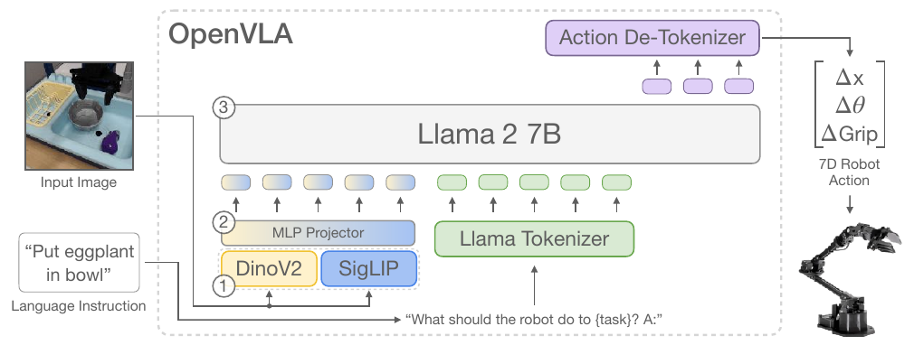

# OpenVLA

> 完整英文标题：OpenVLA: An Open-Source Vision-Language-Action Model
>
> 作者（所读版本）：Moo Jin Kim、Karl Pertsch、Siddharth Karamcheti（同等贡献）、Ted Xiao、Ashwin Balakrishna、Suraj Nair、Rafael Rafailov、Ethan Foster、Grace Lam、Pannag Sanketi、Quan Vuong、Thomas Kollar、Benjamin Burchfiel、Russ Tedrake、Dorsa Sadigh、Sergey Levine、Percy Liang、Chelsea Finn。
>
> 发表出处与时间：CoRL 2024，2024 年 11 月，德国慕尼黑。PMLR 第 270 卷于 2025 年刊载。目录按会议年份归档，笔记中的方法和数字以提供的 37 页 arXiv:2406.09246v3（2024-09-05）为准。
>
> 原文与代码：[arXiv v3](https://arxiv.org/abs/2406.09246v3) · [会议论文集](https://proceedings.mlr.press/v270/kim25c.html) · [项目主页](https://openvla.github.io/) · [官方实现](https://github.com/openvla/openvla)
>
> 阅读日期：2026-11-15
>
> 阅读深度：精读（正文、主要图表和实验附录，未复现）
>
> 主题标签：机器人操作、视觉语言动作模型、动作离散化、Open X-Embodiment、LoRA、量化

## 一句话总结

OpenVLA 用约 97 万条实机轨迹把 Prismatic 视觉语言模型微调成操作策略，将 7 维末端执行器动作表示为可自回归生成的 Token。作者报告其在 WidowX 和 Google Robot 的 29 项任务上比 RT-2-X 高 16.5 个成功率百分点，并验证了小样本适配、LoRA 和量化部署。

## 问题与背景

单任务策略常能容忍初始姿态变化，遇到新物体、干扰物或新指令时却容易操作错对象。VLM 从网络数据获得的语义先验可以帮助选择对象，机器人示范则提供场景和语言对应的控制动作。论文关注如何用开放的模型、训练代码和机器人数据把这两类能力连起来，以及如何用少量目标域示范适配新的操作环境。

## 核心方法

### 从单帧图像和指令生成 7 维动作

图源为原论文 Figure 2（PDF 第 4 页）。

1. **视觉编码**：输入一张第三人称 RGB 图像，默认分辨率 224 × 224。DINOv2 和 SigLIP 分别编码同一图像，按通道拼接对应 patch 的特征。作者用前者补充空间细节，用后者提供视觉语义。
2. **多模态融合**：两层 MLP 将视觉 patch 特征投影到语言嵌入空间，与指令 Token 一同输入 Llama 2 7B。初始化采用已做图文对齐的 Prismatic-7B。
3. **动作离散化**：位置增量 3 维、旋转增量 3 维、夹爪控制 1 维。每维用训练数据第 1 至第 99 百分位确定区间，均匀划分 256 档。离群值对常见动作分辨率的影响因此减小，解码时需要使用对应数据集的动作统计还原尺度。
4. **训练和执行**：借用 Llama 词表最后 256 个 Token 表示这些档位，按动作维度生成序列，交叉熵只监督动作 Token。运行时将 Token 解为一条 7 维命令，执行后读取新图像并再次预测，形成闭环。

这里的 256 是**每一维**的离散档数，单步输出由各维组合而成。动作坐标系、尺度和夹爪编码都影响同一 Token 最终执行的物理动作。

### 训练数据与配方

从 Open X-Embodiment 筛出有至少一个第三人称相机、且能用单臂末端执行器控制表示的操作数据，组成约 97 万条实机轨迹的训练配方。采样权重沿用 Octo 的多样性启发式。DROID 初期以约 10% 混入，由于训练中动作 Token 准确率持续较低，最后三分之一训练将其移除。BridgeData V2 还清理了全零动作，附录 C 记录了未经清理的策略容易停在原地。

主模型全量微调，包括视觉编码器，固定学习率 2e-5，批大小 2048，共 27 个 epoch。论文报告用 64 张 A100 训练 14 天，约 21,500 A100 GPU 小时。较小的 Bridge 实验中，384 × 384 输入训练时间约为 224 × 224 的 3 倍，所测任务未观察到性能收益；附录 D 对数据混合、双视觉编码器及冻结视觉编码器分别做了对照。

## 实验与证据

### 直接部署：29 项跨机器人操作任务

WidowX 的 BridgeData V2 设置包含 17 项任务、每项 10 次。Google Robot 包含 12 项任务、每项 5 次。同一比较中的方法使用相同的任务和机器人、物体初始状态。论文报告相对 55B RT-2-X 的汇总成功率优势为 **16.5 个百分点**，主要来自 BridgeData V2。Google Robot 两者整体接近，Figure 4 所示分布外子集均为 82.9%。Bridge 的语义泛化类别中，RT-2-X 表现更好。

OpenVLA 的 97 万条训练轨迹、RT-2-X 的约 35 万条轨迹，以及不同视觉编码器与训练数据清理均可能影响结果。这个实机比较衡量完整策略，附录 D 的小规模对照进一步检查了 OpenX 混合数据与视觉编码器的贡献。

### 新环境适配：Franka 实机和 LIBERO

Figure 5 在 Franka-Tabletop 与 Franka-DROID 的 7 项任务上使用每任务 10–150 条示范，每方法共 129 次实机 rollout。预训练 OpenVLA 的平均表现最高，尤其擅长按多个指令从干扰物中选中目标对象。原文报告其相对从头训练的 Diffusion Policy 汇总提升 **20.4 个百分点**。Diffusion Policy 在部分单指令任务上仍占优，且完整版本使用本体感知、观测历史和动作分块。论文也提供了输入输出规格与 OpenVLA 对齐的 matched 版本。

附录 E 在 LIBERO 用 LoRA 微调。每套任务每个种子 500 次试验，共 3 个种子。OpenVLA 在 Spatial / Object / Goal / Long 上分别为 **84.7 / 88.4 / 79.2 / 53.7%**，平均 76.5%，同表 Octo 和 Diffusion Policy 平均为 75.1% 和 72.4%。Object、Goal 的最高分分别来自 Diffusion Policy 和 Octo。复现时需沿用附录描述的图像方向与训练示范过滤。

### LoRA 与量化的证据边界

§5.3–5.4 的脚注说明，两节使用**仅含 SigLIP 的简化版本**，其机器人训练数据混合与 Octo 相同。以下数字属于该实验设置。

| 微调方式（Table 1） | 成功率 ± 标准误 | 可训练参数 | 显存（batch 16） |
| --- | --- | --- | --- |
| 全量 | 69.7 ± 7.2% | 7,188.1M | 163.3 GB（两卡 FSDP） |
| 冻结视觉编码器 | 47.0 ± 6.9% | 6,760.4M | 156.2 GB（两卡 FSDP） |
| Sandwich | 62.1 ± 7.9% | 914.2M | 64.0 GB |
| LoRA，rank 32 | 68.2 ± 7.5% | 97.6M | 59.7 GB |
| LoRA，rank 64 | 68.2 ± 7.8% | 195.2M | 60.5 GB |

每种方法在选定的 Franka-Tabletop 任务上评估 33 次。LoRA 应用于全部线性层，rank 32 更新约 1.4% 的参数，观测成功率接近全量微调。论文报告单张 A100 上新任务可在 10–15 小时内微调，表中显存随批大小等设置变化。

| 推理精度（Table 2） | Bridge 成功率 ± 标准误 | 显存 |
| --- | --- | --- |
| bfloat16 | 71.3 ± 4.8% | 16.8 GB |
| int8 | 58.1 ± 5.1% | 10.2 GB |
| int4 | 71.9 ± 4.7% | 7.0 GB |

量化比较覆盖 8 项任务、每个精度 80 次 rollout。A5000 上 int8 约 1.2 Hz，int4 约 3 Hz，而采集数据的非阻塞控制频率为 5 Hz。作者将 int8 的成功率下降主要归因于闭环频率变化。附录 D.4 改用阻塞控制后，各精度表现的误差条重叠。部署时应同时报告显存、实际控制频率和闭环成功率。

## 我的理解与评价

OpenVLA 最有用的贡献是提供了可复用的训练与适配基线。动作 Token 让模型能够沿用 VLM 的训练目标和基础设施，也把控制误差与离散区间、反归一化和硬件时序联系起来。检查预训练数据中看似无害的空动作，以及推理时能否保持与示范接近的节拍，可能比单看离线 Token 准确率更能解释实机失败。

对照实验支持跨数据集预训练和语义条件在多对象任务上的价值。原版策略每轮只接收一帧图像并预测一个动作，论文报告 RTX 4090 上约 6 Hz。遮挡后恢复、需要长历史的任务、高频灵巧操作和双臂协同仍需要其他输入或动作机制。已测任务上的成功率也随平台和任务类别变化。

## 与其他论文的联系

| 工作 | 可比较的问题 |
| --- | --- |
| RT-2 / RT-2-X | OpenVLA 沿用将动作作为语言模型输出 Token 的方法，改用分位数定标、Prismatic 和自己的 OpenX 数据配方。 |
| Octo / Diffusion Policy | Octo 的数据配方是 OpenVLA 的起点之一。两者与 Diffusion Policy 的比较揭示了通用预训练、语言定位和动作平滑性各自的作用。 |
| [OpenFly](../2026-openfly/index.md) | 在 OpenVLA 基础上适配无人机动作，并加入关键帧选择与 Token 合并。可对照单帧操作和长程导航如何使用视觉历史。 |
| [StreamVLN](../2026-streamvln/index.md) · [UrbanVLA](../2026-urbanvla/index.md) | StreamVLN 用多轮缓存生成导航动作。UrbanVLA 用动作头输出局部连续轨迹。它们分别提供了处理观察历史和替代离散动作解码的参照。 |

主题入口：[视觉语言动作模型与机器人操作](../../topics/vision-language-action.md)。

## 后续行动

- [ ] 核对官方实现的动作边界处理、反归一化参数及机器人动作接口。
- [ ] 复核 LIBERO 的示范过滤与 LoRA 配方，将各任务套件的差异和总平均同时记录。
- [ ] 在同一机器人与控制频率下对比离散自回归、连续动作头和动作分块的成功率及延迟。

## 来源定位

Figure 2 与 §3 描述架构、动作编码和数据。Figures 3–5、附录 B/C 对应实机比较。Tables 1–2 和附录 D.4 对应 LoRA、量化与阻塞控制，附录 E 的 Table 12 对应 LIBERO。会议和论文集年份据 PMLR 与会议版本记录。
