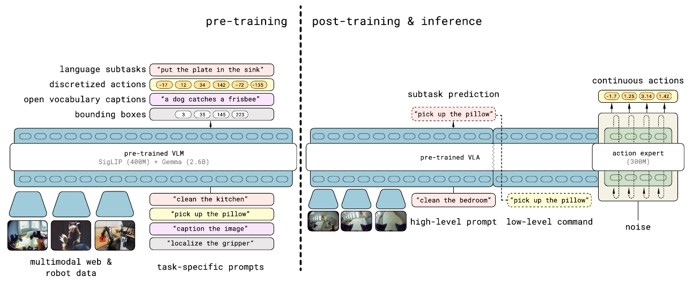

# π₀.₅

> 完整英文标题：π₀.₅: a Vision-Language-Action Model with Open-World Generalization
>
> 作者：Physical Intelligence 团队，Kevin Black、Noah Brown、James Darpinian 等。
>
> 发表出处与时间：CoRL 2025，2025 年 9 月，韩国首尔。PMLR 第 305 卷，17–40 页。本笔记依据用户提供的 19 页 arXiv:2504.16054v1（2025-04-22）。
>
> 原文与代码：[arXiv v1](https://arxiv.org/abs/2504.16054v1) · [会议论文集](https://proceedings.mlr.press/v305/black25a.html) · [项目主页](https://www.pi.website/blog/pi05) · [OpenPI](https://github.com/Physical-Intelligence/openpi)
>
> 阅读日期：2026-11-15
>
> 阅读深度：精读（正文、实验图表和附录，未复现）
>
> 主题标签：视觉语言动作模型、移动操作、异构数据共训练、FAST、流匹配、分层推理、开放世界泛化

## 一句话总结

π₀.₅ 将跨机器人操作、网页视觉任务与语义子任务一起训练，部署时用同一个模型先决定下一步做什么，再由流匹配动作专家生成连续动作块，在三套未见真实住宅中完成多步整理任务的相当一部分步骤。

## 问题与背景

在陌生厨房里收拾碗碟，机器人既要认出不同样式的杯盘和水槽，也要根据场景决定先搬哪件、如何靠近、何时停。面向目标平台的家庭示范能教会这些技能，但很难覆盖所有物体、环境和组合。论文研究廉价或更丰富的数据能否补足直接经验，包括固定机械臂收集的家庭操作、实验室跨本体数据、网页语义和人类口头子任务指令。

## 核心方法

图源为原论文 Figure 3（PDF 第 4 页）。

### 同一模型的两级推理

输入为多相机图像、本体状态与任务指令，骨干由 PaliGemma 初始化。模型先自回归生成下一条语义子任务，例如从“收拾卧室”得到“捡起枕头”，再以子任务和观测为条件生成低层动作块。两级推理共享视觉语言骨干，连续动作 Token 由约 300M 参数的动作专家处理。注意力掩码让动作专家读取观测和指令前缀，同时隔开 FAST 动作 Token 与连续动作 Token。

### 两阶段训练与不同的动作表示

1. **预训练，28 万步**。使用标准下一 Token 预测，统一监督语言、边界框位置和经 FAST 压缩的离散动作块。机器人动作按各数据集的第 1、99 百分位归一化，不同维度补零对齐。提示中标记关节或末端执行器控制模式。
2. **后训练，8 万步**。加入随机初始化的动作专家，同时优化离散 Token 交叉熵和连续动作流匹配损失，论文式 (1) 的流匹配权重为 10。训练时把噪声和真实动作块混合，让专家拟合流向量场。推理时从高斯噪声出发，做 10 步积分生成包含 50 个控制步的连续动作块。

离散表示支持高效的多任务预训练，连续专家支持较快、细粒度的成段动作生成。实机为两类双臂移动操作平台，状态与动作空间为 18 或 19 维。高层读取前、后和双腕四个相机，低层用前视与双腕相机。关节、夹爪、升降机构和底盘由动作目标及低层控制器以 50 Hz 执行，这个频率是控制频率。

### 异构数据如何组合

| 数据 | 内容 | 用途 |
| --- | --- | --- |
| MM | 约 400 小时移动操作，来自约 100 个家庭环境 | 目标平台的获取、移动及整理经验 |
| ME | 在多样家庭里用固定单臂或双臂采集的示范 | 扩展环境与物体覆盖 |
| CE | 实验室多机器人、多任务操作，包括 Open X-Embodiment | 跨本体技能迁移 |
| HL | 多步操作的人工子任务标签和相关边界框 | 根据观测与总指令选择下一步 |
| WD | 网页图像描述、视觉问答和目标定位 | 学物体语义和视觉定位 |
| VI | 专家口头指挥已有低层策略完成多步任务 | 为高层提供与低层能力匹配的示范 |

预训练中 97.6% 的样本来自目标家庭移动操作以外的来源。后训练保留成功且时长达标的 MM/ME 操作轨迹、相应 HL、网页数据，并加入 VI，移除实验室 CE 数据。

## 实验与证据

### 真实家庭与搭建场景

真实家庭定量试验覆盖 **3 套未见住宅**，任务为物品入抽屉、餐具入水槽、衣物入篮，图中按场景和任务汇报平均进度。多数试验约 **2–5 分钟**。论文另展示约 **10–15 分钟**的长任务，统一的定量比较以图 7 等试验为准。搭建的未见厨房和卧室用于消融，另有铺床任务。标准搭建场景评估为每策略每任务计划 10 次，共 40 次，附录 B 说明少数取消试验会剔除。

**任务进度**用完成步骤所得分数除以总分。例如餐具入水槽有 4 件餐具，拾起和放入各得 1 分，总分 8。抽屉任务还奖励打开、放入和关上抽屉等步骤。图 7 的百分比是平均进度。图 9、11 另报语言跟随率（选对指定物体）和成功率（正确放到指定位置）。

### 三组主要对照

| 问题 | 结果与证据 |
| --- | --- |
| 增加训练地点有何影响？ | 图 8、9 将后训练地点从 3 增至 12、22、53、82、104 个。固定 4 万步，使各模型看到的独特样本数相当。平均任务进度整体提高，104 地点模型接近包含测试地点数据的同域对照。中间点有回落，结果支持总体趋势。 |
| 哪些数据有用？ | 图 10 中，移除 ME 或 CE 均使搭建场景进度显著下降，同时移除两者下降更大。移除网页数据对这项平均进度的差异未达显著（p = 0.385），但图 11 显示未见类别物体的跟随和放置表现明显下降。网页数据的收益取决于评测要求。 |
| 分层推理能带来什么？ | 图 12 中，完整 π₀.₅ 优于 π₀ 与只用动作数据的 π₀-FAST+Flow。图 13 中，完整模型平均进度最高。训练时仍用 HL、运行时直接解动作的 implicit HL 次之（与完整模型比较 p = 0.144），训练时也去掉 HL 的版本更弱（p = 0.011）。语义监督的作用有直接证据，显式推理本身的增益还需更大样本确认。 |

图 13 还用零样本 GPT-4 或人类给相同低层策略选子任务，两者在该协议中的成绩均低于完整模型。这反映当前低层策略对高层提示的适配，也受任务与输入条件约束。

## 我的理解与评价

这篇工作的主要贡献是让每种数据负责擅长的层面，再用子任务语言连接它们。别的机器人可以提供抓取和折叠经验，网页任务提供物体概念，口头示范则帮助选择当前低层策略能执行的步骤。对照结果提示，新增地点的覆盖和新增数据的种类是两个值得分别控制的变量。

论文报告了把手难开、手臂遮住污渍、反复开关同一抽屉等失败。高层主要依赖当前观测，跨房间找物、记住物品位置和执行更复杂指令还有待验证。评估专注于两类移动双臂平台与家庭整理任务，完整家庭清理的成功率、干预频次和失败后恢复仍需专门报告。

## 与其他论文的联系

| 工作 | 可比较的问题 |
| --- | --- |
| [OpenVLA](../2024-openvla/index.md) | 两者都从 VLM 迁移到机器人控制。OpenVLA 每步自回归生成离散末端动作，π₀.₅ 用离散动作块预训练，部署时以连续流匹配解码，并显式生成语义子任务。 |
| π₀ / π₀-FAST | π₀ 提供连续流匹配动作专家，FAST 提供动作块的离散压缩。π₀.₅ 把它们用于不同训练阶段，并加入语义子任务和网页监督。 |
| [UrbanVLA](../2026-urbanvla/index.md) | 都将高层语义与低层执行关联。UrbanVLA 接收地图服务生成的路线，π₀.₅ 在操作过程中从场景与总任务预测下一条子任务。 |

主题入口：[视觉语言动作模型与机器人操作](../../topics/vision-language-action.md)。

## 后续行动

- [ ] 核对 OpenPI 中 FAST 预训练、流匹配分支、注意力掩码与控制频率的实现。
- [ ] 按对象类别和任务阶段复查数据消融，分别比较选对物体、成功执行和整段完成。
- [ ] 在相同低层策略和高层信息条件下扩大分层推理对照，记录重复子任务、恢复和人工干预。

## 来源定位

§IV 与 Figures 3–5 对应架构、数据和控制平台。§V 与 Figures 6–13 对应实机评测、训练地点规模和消融。附录 B–E 提供评分、语言跟随评估、逐任务结果及注意力掩码。会议时间与卷页据 PMLR 论文集。
