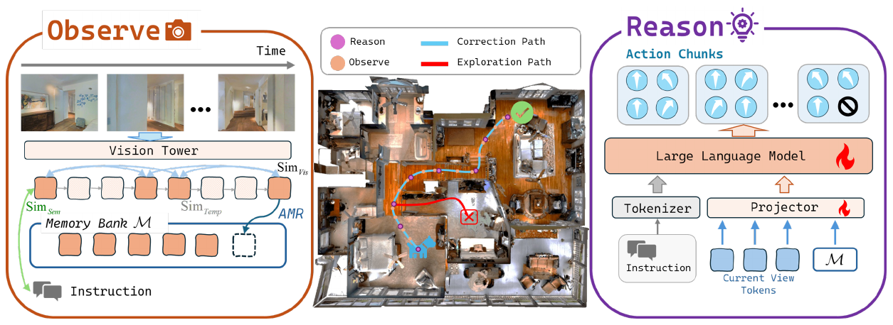

# DecoVLN

> 完整英文标题：DecoVLN: Decoupling Observation, Reasoning, and Correction for Vision-and-Language Navigation
>
> 作者（PDF 署名）：Zihao Xin、Wentong Li（同等贡献）、Yixuan Jiang、Bin Wang、Runmin Cong、Jie Qin、Shengjun Huang。
>
> 发表出处与时间：CVPR 2026，2026 年 6 月，美国丹佛。笔记依据提供的 16 页 arXiv:2603.13133v3（2026-03-26）。
>
> 原文与项目入口：[arXiv v3](https://arxiv.org/abs/2603.13133v3) · [CVF 补充材料](https://openaccess.thecvf.com/content/CVPR2026/supplemental/Xin_DecoVLN_Decoupling_Observation_CVPR_2026_supplemental.pdf) · [作者仓库](https://github.com/Allenxinn/DecoVLN)
>
> 阅读日期：2026-11-16
>
> 阅读深度：精读（正文、主要图表和附录，未复现）
>
> 主题标签：VLN-CE、流式感知、历史帧选择、动作分块、纠偏微调、仿真到现实

## 一句话总结

DecoVLN 在动作执行期间持续观测，按指令相关性、画面差异和时间覆盖筛选历史帧，每轮生成四个离散动作，并用专家路径附近的偏航状态训练纠偏。Table 1 中，纯 RGB 模型在 R2R-CE 和 RxR-CE 未见验证集的成功率分别为 **56.3%** 和 **54.2%**。

## 问题与背景

长程导航的两个误差来源是漏看线索和偏离路线。只在动作结束后观测，可能错过转身时短暂出现的地标。持续保存历史再均匀采样，则可能让重复墙面占掉有限的上下文。与此同时，用专家轨迹监督的策略一旦偏航，就会遇到训练中很少见到的画面，误差可能继续累积。DecoVLN 分别处理历史帧选择、动作生成和纠偏示范采集。

## 核心方法



图源为原论文 Figure 1（PDF 第 3 页）。中间的俯视图示意仿真中的探索与纠偏轨迹。实际策略以第一人称 RGB 和指令为输入。

### 观测：自适应记忆筛选（AMR）

机器人移动时持续接收图像，在观测阶段更新常驻显存的记忆。对候选池 C，模型逐次选取当前得分最高的帧并加入已选集合 M，直到达到预算 K。式 (1) 可写为：

```text
score(f) = λ_R × SimSem(f, I)
           - (1 - λ_R) × [w_V × SimVis(f, M) + w_T × SimTemp(f, M)]
w_V + w_T = 1
```

- **指令相关性**取图像与指令嵌入的余弦相似度。
- **视觉重复**取候选帧与已选帧的最大余弦相似度，抑制相似画面连续入选。
- **时间重复**取最近已选帧的时间差加 ε 后的倒数，鼓励覆盖更分散的时刻。

这是逐帧的贪心选择。与体素去重相比，它只用 RGB 及时间信息，并直接引入指令相关性。

### 推理：最近观测加历史记忆，生成四步动作

模型基于 LLaVA-Video-7B，视觉塔为 SigLIP，语言主干为 Qwen2-7B。每轮输入自然语言指令、**最近四帧**及 **K = 8** 的历史记忆，自回归输出四个动作组成的块。仿真动作集合为前进 25 cm、左转 15°、右转 15°、停止。持续观测与语言模型生成动作使用不同节拍，可在执行期间收集沿途线索。

### 纠偏：在可信邻域采集状态–动作对

先用 R2R-CE、R2R-EnvDrop、RxR-CE 的约 **36 万**仿真样本做监督微调。附录 B 说明训练增强包括动作轻微扰动、图像变化及由 Qwen3 改写的反向路线指令。

纠偏阶段用初始策略在 Habitat rollout。对于当前状态，计算到专家参考轨迹上任意状态的最短可行走路径距离，取最小值 D。按 Algorithm 1：

| 偏离距离 | 采集处理 |
| --- | --- |
| D = 0 | 继续 rollout，此步无需新增纠偏示范。 |
| 0 < D ≤ τ | 查询 Habitat 的最短路径专家，将当前状态、RGB 和专家动作保存为纠偏样本。 |
| D > τ | 终止该次采集，避免继续收集严重偏离后的标签。 |

选用 τ = 3，收集约 **18 万**个纠偏样本，并混训 LLaVA-Video-178K 视觉问答以保留视觉语言能力。导航训练报告约 **600 A800 GPU 小时**。仿真中用到的测地距离和最短路径专家用于生成监督。部署时由学到的策略利用更新的视觉继续导航。

## 实验与证据

### 标准未见验证集

Table 1 摘录。NE 为终点误差，单位为米，SR 为成功率，SPL 同时考虑成功与路径长度，nDTW 衡量路线对齐。

| 方法 | 观测 | R2R NE / SR / SPL | RxR NE / SR / SPL / nDTW |
| --- | --- | --- | --- |
| ETPNav | 全景、深度、里程计 | 4.71 / 57.0 / 49.0 | 5.64 / 54.7 / 44.8 / 61.9 |
| NaVILA（额外数据） | RGB | 5.22 / 54.0 / 49.0 | 6.77 / 49.3 / 44.0 / 58.8 |
| StreamVLN（正文所列） | RGB | 5.43 / 52.8 / 47.2 | 6.72 / 48.6 / 42.5 / 60.2 |
| DecoVLN | RGB | **5.01 / 56.3 / 50.5** | **5.73 / 54.2 / 46.3 / 63.5** |

对正文的 StreamVLN 行，DecoVLN 的 SR 在 R2R 和 RxR 分别高 3.5 和 5.6 个百分点。R2R 的 SPL 表值差为 **3.3** 个百分点（50.5 − 47.2），§4.3 写为 2.8。ETPNav 的两个 SR 仍略高。DecoVLN 未使用额外的 ScaleVLN 导航数据。

附录 Table 7 换用了另一组 StreamVLN 比较数字，并将 DecoVLN 的 R2R SR 写为 **56.1**。其中 StreamVLN RGB 为 55.7 / 51.8 SR，RGB + Depth 为 56.9 / 52.9 SR，两组按 R2R / RxR 排列。与后者相比，DecoVLN 在 R2R 较低、RxR 较高。[StreamVLN 笔记](../2026-streamvln/index.md)记录的是其自身 arXiv v2 的 Table I。比较时应对齐版本、训练数据和是否启用深度剪枝。

### 模块、样本量与长路线

| 对照 | 主要结果 |
| --- | --- |
| AMR 和纠偏，Table 2 | R2R 上，均匀采样基线 SR / SPL 为 47.3 / 43.9，加 AMR 后为 50.9 / 46.1，再加入纠偏阶段为 56.3 / 50.5。NE 从 5.89 降至 5.01 米，绝对差为 0.88 米。表中没有只加纠偏的行。 |
| 记忆长度，Table 3 | AMR 的 K 从 2 增至 8 时，R2R SR 从 41.9 提升到 50.9，K = 12 时为 50.7。RxR 在 K = 8 / 12 时分别为 49.2 / 49.5 SR。K = 8 是作者选用的折中。 |
| 可信邻域与 DAgger，Tables 4–5 | 测试 τ = 1、3、6。τ = 3 的 R2R SR 与 SPL 最好，RxR 的 SR 在 τ = 6 时略高。等量 18 万纠偏数据下，R2R SR / SPL 从普通 DAgger 的 54.8 / 49.6 提升到 56.3 / 50.5。24 万普通 DAgger 为 56.0 / 50.3，OS 略高。 |
| 长路线，Figure 5 | 从 R2R/RxR 验证轨迹拼接路径并用 Qwen3 合并指令，构造 536 条、平均 23 米的路线。对该集合，StreamVLN → DecoVLN 的 SR 为 32.8 → 36.9，OS 为 37.2 → 42.5，NE 为 6.62 → 6.28 米。 |

### 实机部署

Unitree Go2 的 Jetson Orin 负责语音识别和低层运动控制，远端 RTX 4090 从无线传输的画面和指令生成动作块。控制器把四个符号动作合成相对位姿目标，再执行平滑运动。VLN 策略未用实机轨迹微调。Figures 4、8 提供办公室等环境中的定性案例，论文未给出统一的实机试验次数、成功率或端到端延迟分布。

## 我的理解与评价

AMR 把历史帧选择移到观测阶段，推理直接读取精简的历史。最有说服力的对照是相同记忆预算下比较均匀采样和任务相关帧，以及同为 18 万样本时比较可信邻域和普通 DAgger。复现还应分别测量缓存大小、逐帧评分成本和动作生成开销，才能判断异步设计对闭环延迟的实际贡献。

可信邻域筛掉远离指令路径的监督，但训练样本也更集中在轻中度偏航。路径距离衡量几何偏离，无法直接区分走到了错误阶段、身份相似的地标或方向错误等问题。彻底迷路后的恢复，以及长动作块遇到突发障碍时如何提前重规划，仍是开放问题。

## 与其他论文的联系

| 工作 | 可比较的问题 |
| --- | --- |
| [StreamVLN](../2026-streamvln/index.md) | StreamVLN 用多轮滑窗复用 KV，几何剪枝是可选项。DecoVLN 在观测阶段按语义、视觉、时间排序历史帧，并用测地距离约束纠偏采集。 |
| [OpenFly](../2026-openfly/index.md) | 都选择任务相关关键帧。OpenFly 用动作变化筛候选、以地标框监督 grounding，并合并视觉 Token。DecoVLN 的选择目标显式加入历史时间覆盖。 |
| [AerialVLN](../2023-aerialvln/index.md) | LAG 与 DecoVLN 都利用参考路线指导偏航恢复。LAG 关注监督子目标的选择，DecoVLN 同时按偏离程度选择哪些状态进入训练集。 |

主题入口：[连续环境视觉语言导航](../../topics/continuous-vision-language-navigation.md)。

## 后续行动

- [ ] 核对候选池更新、第一帧选取、时间归一化和记忆权重设置。
- [ ] 对齐 StreamVLN 的版本、额外训练数据和观测设置，复核同条件结果。
- [ ] 按偏航距离与类型评估恢复，记录动作块长度变化对成功率、显存和闭环延迟的影响。

## 来源定位

§3、Figure 1 与 Algorithm 1 对应记忆和纠偏。§4、Tables 1–5、Figure 5 给出主结果与消融。附录 B–E 提供训练增强、StreamVLN 对照、部署和局限。会议月份及地点见 [CVPR 2026 官方报道](https://cvpr.thecvf.com/Conferences/2026/News/Closing)。
