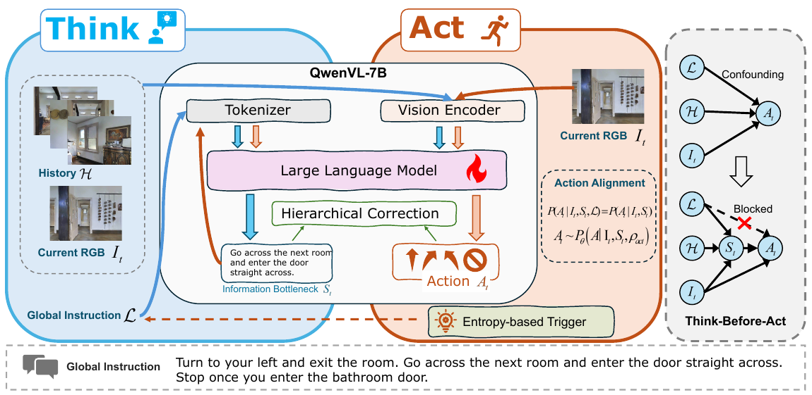

# IDEAL-VLN

> 完整英文标题：Instruction Decomposition and Action Alignment for Vision-and-Language Navigation
>
> 作者：Zihao Xin、Wentong Li、Yixuan Jiang、Bin Wang、Piji Li、Jianke Zhu、Jie Qin、Shengjun Huang。
>
> 发表出处与时间：ICML 2026，2026 年 7 月，韩国首尔。PMLR 第 306 卷，139919–139934 页。以下方法与实验数字以提供的 16 页会议稿为准。
>
> 原文与项目入口：[PMLR 论文集](https://proceedings.mlr.press/v306/xin26a.html) · [项目主页](https://allenxinn.github.io/IDEALVLN)
>
> 阅读日期：2026-11-16
>
> 阅读深度：精读（正文、主要图表和附录，未复现）
>
> 主题标签：VLN-CE、指令分解、语义锚点、自适应重规划、分层纠偏、仿真到现实

## 一句话总结

IDEAL-VLN 先用完整指令和历史图像判断当前应执行哪条子指令，再凭子指令和最近三帧生成动作。它用动作序列中的转向模式判断何时更新子指令，并在仿真训练中分别纠正子指令和轨迹偏离。使用额外训练数据时，纯 RGB 策略在 R2R-CE 和 RxR-CE 未见验证集的成功率分别为 **59.8%** 和 **59.1%**。

## 问题与背景

长指令经常同时描述过去要经过的地标、眼前该走的门和后续停靠地点。模型每一步都看完整指令时，可能被远处已可见、却还没轮到的地标吸引，提前执行后面的步骤。每步重复编码历史图像也会增加计算。IDEAL-VLN 将长程指令进度交给低频的子指令生成，再让频繁执行的动作模块只处理当前目标。

## 核心方法



图源为提供的会议稿 Figure 1（PDF 第 3 页）。

### 先确定当前子指令，再生成动作

1. **语义锚定（Think）**：以全局指令和视觉历史为条件，生成当下的一段子指令，例如“穿过这个房间，进入正对面的门”。附录 C.2 从历史均匀采样 8 帧作为上下文。
2. **动作对齐（Act）**：共享 Qwen2.5-VL-7B 骨干，只根据当前子指令与最近 3 帧第一人称 RGB 生成一段离散微动作。动作集合包括前进、左转、右转和停止，单次转角为 15°。

作者把子指令视为全局文本到动作之间的中介。通过输入约束，全局文本只能经子指令影响当步动作。这是模型结构施加的条件依赖关系，评估还需要看子指令是否完整保留了当前决策所需的信息。附录还检查新旧子指令在全局指令中的顺序连贯性，检测到跳步时补齐缺失步骤。

### 何时重新判断当前子指令

同一锚点可以沿用多个动作块。正文将触发策略称为 action entropy，实际列出的规则直接检查已经生成的动作序列：

- 同一块中同时出现左转与右转，视为犹豫或动作冲突。
- 同方向的转向动作达到指定次数，视为视野可能已经切换。

触发条件无需增加视觉模型，也无需另外计算动作概率的熵。触发后会重新运行 Think，因此仍有推理成本。论文在实机系统中把这一步安排在机器人执行上一段动作期间。

### 同时纠正错误子指令与偏航

- **语义级思路纠正（STC）**：仿真 rollout 时，按当前所在位置查询专家路径最近的两个路点及其对齐指令，得到专家子指令。用预测文本和专家文本的有效词交集大小除以预测文本的有效词数。低于阈值 τ = 0.8 时，用专家子指令替换错误预测，并把正确标签写入纠偏数据。这个词重合比例计算简单，同义改写或关键词相同而方向不同的情况仍需额外检查。
- **空间自适应干预（SAI）**：令 d 为当前位置到最近专家路点的测地距离。用 Logistic 门控决定调用专家的概率：

```text
P(专家干预 | d) = 1 / [1 + exp(-k × (d - μ))]
k = 3，μ = 1.5 米
```

靠近路径时模型保留探索机会，偏离较远时更可能由专家介入。d = μ 时干预概率为一半。专家和参考路径只用于训练阶段的数据采集。

### 训练数据

指令对齐数据集在 Matterport3D 的 61 个室内场景中重采 R2R、RxR 轨迹，得到约 **16 万对图像与子指令**。Qwen3-VL-235B 从完整指令和图像中提取对应片段，RxR 时间戳用于核对顺序，人工筛除跳步和异常输出。

模型先从仿真专家示范学习基础动作与指令对齐，再进行纠偏微调。完整配方还加入 **ScaleVLN-150K** 和从 LLaVA-Video-178K 抽取的 **8 万**视频问答。ScaleVLN 样本仍用完整指令训练。训练使用 8 张 H100，冻结视觉编码器和多模态投影层。

## 实验与证据

### R2R-CE 与 RxR-CE 未见验证集

Tables 1–2 摘录。SR 衡量停在目标 3 米内的比例，SPL 按实际路径效率加权，NE 表示终点测地误差，nDTW 衡量与参考路线的对齐。† 表示对应主表标注的额外数据设置。

| 方法 | R2R SR / SPL | RxR SR / SPL | 说明 |
| --- | --- | --- | --- |
| ETPNav | 57.0 / 49.0 | 54.7 / 44.8 | 全景、深度与里程计 |
| StreamVLN† | 55.7 / 50.9 | 51.8 / 45.0 | RGB，使用本文主表引用的数字 |
| NavFoM† | 56.2 / 51.2 | 57.4 / 49.4 | RGB |
| IDEAL-VLN | 56.7 / 51.6 | 55.9 / 48.2 | RGB，基础数据设置 |
| IDEAL-VLN† | **59.8 / 52.9** | **59.1 / 50.7** | RGB，含额外训练数据 |

完整版本相对基础版本的 SR 分别高 3.1、3.2 个百分点。R2R 的基础版本 SPL 高于 ETPNav，SR 略低。主表引用的 StreamVLN† 数字与其论文 v2 的主表不同，跨论文对照应保留各自版本和训练配方。

### 分层与纠偏消融

Figure 2 在 RxR-CE 上把完整指令基线的 SR 从 **42.7** 提升到加入 Think-Before-Act（TBA）的 **51.1**，再到加入分层纠偏（HCM）的 **55.9**，最后在添加额外数据后到 **59.1**。这些是逐项叠加，有助于区分算法结构和额外数据的贡献。

| RxR 对照 | SR / SPL | 如何解读 |
| --- | --- | --- |
| TBA + 动作序列触发 | 51.1 / 45.9 | Table 3，与阈值规则成本一起比较。 |
| TBA + SigLIP 相似度触发 | 51.5 / 46.0 | 成绩接近，论文报告额外约 0.9 GB 显存。 |
| TBA + LLM 置信度触发 | 35.8 / 29.2 | 该实现低于完整指令基线 42.7 / 37.8。 |
| TBA + 普通 DAgger → STC → 完整 HCM | 51.6 / 46.3 → 53.2 / 47.1 → 55.9 / 48.2 | Table 4 的三个纠偏方案。HCM 相对无纠偏 TBA 的 SR 增加 4.8 个百分点。 |

Figure 5 用 RxR 未见分割上的关键词重合口径评估子指令对齐。微调后的 Qwen2.5-VL-7B 得分为 78.96%，StreamVLN 为 29.31%，Qwen3-VL-235B 约 80.7%。这项得分衡量局部指令对齐，和闭环导航成功率对应不同任务。

### 推理开销与实机

Table 6 的单回合比较中，完整指令基线做 21 次动作推理，约 **147K Token、2,310T prefill FLOPs**。IDEAL-VLN 做 5 次 Think 和 21 次 Act，共约 **77K Token、1,180T prefill FLOPs**。动作阶段每次约 2K Token，基线约 7K。该表对应给定轮数的成本，触发更频繁时节省幅度会改变。

Unitree Go2 使用 RealSense D455 采集 RGB，Jetson Orin 转录语音，远端 RTX 4090 推理。论文报告动作响应回路在 0.2 秒内，子任务推理约 2 秒，可与约 3–5 秒的动作执行重叠。Figure 3 展示未见办公室里的零样本迁移案例，未报告实机任务总数、成功率和延迟分位数。

## 我的理解与评价

子指令把“当前走到哪一步”变成可检查的输出。这样能直接区分两类失败：选错目标，或目标正确但没走好。TBA 与普通 DAgger 的对照说明，只重标动作难以修复上游指令错误。实际使用时，子指令过早切换、词面相似但方向错误、连续同向转弯引起的误触发，都值得单独统计。

效率收益还来自动作阶段大幅减少历史视觉输入。若要把它与指令缩短的贡献分开，需要固定视觉帧数比较两种文本条件。实机效率也受动作块执行时长与网络影响，单回合 FLOPs 适合判断计算量，闭环延迟仍需独立测量。

## 与其他论文的联系

| 工作 | 可比较的问题 |
| --- | --- |
| [DecoVLN](../2026-decovln/index.md) | DecoVLN 为动作推理筛选高价值历史，并用硬阈值过滤偏航训练样本。IDEAL-VLN 让历史主要服务子指令预测，用软概率干预，并额外纠正预测子指令。 |
| [StreamVLN](../2026-streamvln/index.md) | StreamVLN 用滑动窗口复用 KV、压缩历史视觉 Token。IDEAL-VLN 降低使用完整历史与全局指令的频率，两者针对不同的推理成本。 |
| [π₀.₅](../2025-pi05/index.md) | 都让高层生成语言子任务再执行。π₀.₅ 用流匹配生成连续操作动作，IDEAL-VLN 用子指令约束离散导航动作，并提供仿真中的两级纠偏。 |

主题入口：[连续环境视觉语言导航](../../topics/continuous-vision-language-navigation.md)。

## 后续行动

- [ ] 核对触发规则的同向转向阈值、子指令连贯性补齐逻辑及停止动作的处理。
- [ ] 固定骨干、数据和视觉帧预算，比较全指令与子指令，分别计量成功率、触发频率与端到端延迟。
- [ ] 按跳步、误转、提前停止和偏航距离分组，复查 STC 与 SAI 的作用。

## 来源定位

Figure 1、§3.1–3.3 描述两级推理与纠偏。Tables 1–5、Figure 2 对应仿真结果与消融，Table 6、Figures 3–5 对应推理成本、实机和语言对齐评估。附录 C 对应数据标注、训练及部署输入。
