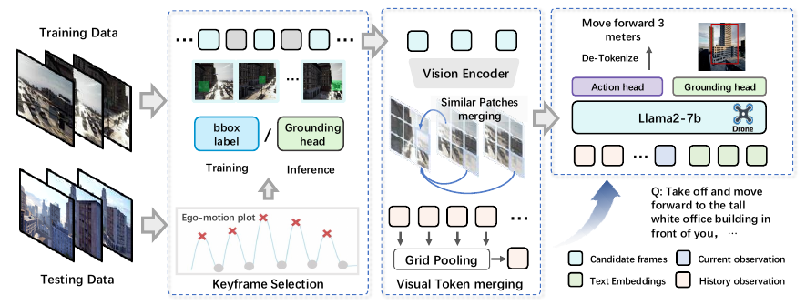

# OpenFly

> 完整英文标题：OpenFly: A Comprehensive Platform for Aerial Vision-Language Navigation
>
> 作者：Yunpeng Gao、Chenhui Li、Zhongrui You、Junli Liu、Zhen Li 等；前五位为共同第一作者，通讯作者为 Zhigang Wang、Bin Zhao。
>
> 发表年份 / 版本：2026（ICLR 2026；[arXiv 页面](https://arxiv.org/abs/2502.18041v7)标注接收信息）。预印本首发于 2025-02-25；本笔记依据提供的 21 页 arXiv:2502.18041v7，修订日期 2026-03-01，目录按 2026 年版本归档。
>
> 原文：[arXiv v7](https://arxiv.org/abs/2502.18041v7)。当前 PDF 未列出可核对的官方代码仓库链接，本次未核查代码发布状态或运行实现。
>
> 阅读日期：2026-11-03
>
> 阅读深度：精读（正文、附录与主要图表；未复现）
>
> 主题标签：空中视觉语言导航、自动数据生成、3D Gaussian Splatting、VLA、关键帧记忆、视觉 Token 压缩

## 一句话总结

OpenFly 将多渲染引擎、自动轨迹与指令生成工具链、100K 航线基准以及关键帧导航模型结合起来：先降低空中 VLN 数据采集成本，再用地标相关历史帧和视觉 Token 压缩改进 OpenVLA，在其未见场景测试集上达到 22.6% SR，并提供了小规模真实无人机实验。

## 问题与背景

[AerialVLN](../2023-aerialvln/index.md) 已建立城市级空中 VLN，但依赖飞手驾驶和人工指令标注，扩大数据规模的成本较高。单一仿真技术也限制了可用场景资源和视觉风格。

OpenFly 同时处理两个问题：

1. **数据怎么规模化生产**：统一不同场景来源的接口，自动寻找无碰撞轨迹，自动生成语言描述。
2. **模型应该记住哪些画面**：均匀抽帧可能错过关键地标，保留所有历史图像又增加计算并稀释任务信号，因此需要选择和压缩历史观测。

阅读时应区分 **OpenFly 平台、OpenFly 数据集和 OpenFly-Agent 模型**，三者分别对应采集能力、评测资源和导航算法。

## 核心方法

### 1. 多引擎场景与统一接口

第 3.1 节及附录 A–C 集成四类渲染来源：

| 来源 | 场景资源 | 作用 |
| --- | --- | --- |
| Unreal Engine | 8 个城市场景；UE4 与 UE5 采用不同插件接口。 | 提供丰富的可交互数字资产。 |
| GTA V | 1 个洛杉矶风格城市。 | 补充城市外观、交通和光照风格。 |
| Google Earth | Berkeley、Osaka、Washington D.C.、St. Louis 共 4 个区域。 | 补充真实地理区域的高空影像。 |
| 层次化 3D GS | 5 个校园场景，由无人机照片重建。 | 将真实场景带入可渲染环境，即 real-to-sim。 |

合计 18 个场景。统一接口覆盖智能体移动、点云获取和图像获取；`CoorTrans` 将不同引擎的位姿与尺度转换为以米为单位的 FLU（前、左、上）坐标约定。

3D GS 重建的真实场景仍属于渲染环境；只有第 6.4 节的实际飞行才是实机验证，不能混为一谈。

### 2. 自动数据生成工具链

第 3.2 节及附录 D–G 的流程：

1. **获取点云**：UE、GTA V 通过栅格采样拼接点云；3D GS 可利用 COLMAP 重建时产生的稀疏点云。
2. **识别地标**：采用 3D 场景理解、点云投影与轮廓提取等方法，结合 VLM 生成语义描述；平台也保留人工标注接口。
3. **生成航线**：在体素占据图中选地标、起点和终点，以自定义动作空间运行 A*；串接多个子目标可生成复杂路线。Google Earth 的视角获取受限，附录 E 对其使用预采集栅格图像上的路径搜索。
4. **生成指令**：根据动作转换切分子轨迹，忽略轻微角度调整；将每段动作与末尾三帧输入 VLM（如 GPT-4o），描述动作及地标，再由 LLM 合并子指令。
5. **过滤和质检**：剔除损坏图片、低于树高的异常轨迹，以及动作数少于 2 或多于 150 的路线；利用 NLTK、句向量相似度合并重复地标描述，并开展人工抽检。

分段生成的关键是让语言围绕动作变化与地标组织，减少整段视频输入的成本和理解难度。**高度自动化不等于完全无人参与**：真实场景采集、可选人工语义标注和数据质检仍需要人工。

### 3. OpenFly-Agent：保留与地标有关的历史

模型基于 OpenVLA，使用视觉编码器与 Llama2-7B，输入当前图像、历史观测和指令，输出无人机动作。主要加入两个模块：

**关键帧选择（KS）**：动作方向的明显变化通常出现在关键地标附近，先据此选取附近候选帧；再用三层交叉注意力组成的 grounding 模块预测指令相关地标框，保留地标框面积超过阈值的候选帧。训练时利用工具链提供的框标签监督 grounding，测试时由模型预测。

**视觉 Token 合并（VTM）**：在关键帧集合中，以地标框最大的帧作为参考，计算跨帧 patch Token 的余弦相似度，将相似 Token 平均合并，丢弃比较帧中未合并的 Token；继续用网格池化压缩历史特征。当前帧保持未压缩，以保留最新决策信息。

图源：原论文 Figure 4，PDF 第 7 页；图中的 grounding 标签用于训练，测试时使用预测框。

我的理解：它维护的是一个小型、任务相关的视觉记忆，而非完整地图。压缩不只是减少计算，也改变了历史与当前观测在语言模型上下文中的信息比例。

### 4. 动作和训练设置

第 4.1、6.1 节列出的关键配置：

| 项目 | 设置 |
| --- | --- |
| 动作类型 | Forward、Turn Left、Turn Right、Move Up、Move Down、Stop，共六类；不同于 AerialVLN 的八类动作。 |
| 前进步长 | 数据生成使用 3、6、9 米，以适应不同目标距离。 |
| 视觉输入 | RGB 图像历史与当前帧；全局点云用于数据生成及碰撞检查，不能据此认定它是导航模型的直接输入。 |
| 当前观测 | 保留 256 个视觉 Token。 |
| 历史记忆 | FIFO memory bank，容量 K = 2；历史经过强压缩。正文写为压缩至 1 个 Token，逐帧或整体的具体张量口径需核对实现。 |
| 地标阈值 | 框面积超过输入图像面积的 0.25 倍。 |
| 训练 | batch size 64，学习率 2e-5；grounding 使用 GIoU loss。 |
| 动作表示 | 词表最后 256 个 Token 用作动作表示，不等于存在 256 种动作类型。 |

平台还支持连续路点生成、DAgger 数据增强和交互式训练，但论文主实验采用离散动作模型，不能将平台全部能力视为主模型已经使用的设置。

## 实验与证据

### 数据规模与划分

Table 1 报告 100K 条航线、15.6K 词汇量，平均路线长 **99.1 米**、**35 个动作**、指令长 **59 个词**。相较 AerialVLN 的平均 661.8 米，OpenFly 明确选择了较短的路线，强调更易扩展的短中程指令。

第 4.2 节报告：

- **Train**：主要由 7 个 UE 场景、4 个 3D GS 场景与 Google Earth 数据组成；UE 占约 75.7%，3D GS 近 20%，Google Earth 约 4.46%。
- **Test Seen**：从 11 个已见场景采样 1,800 条路线。
- **Test Unseen**：从 3 个未见场景采样 1,200 条路线，分别为 UE-smallcity、3D GS-sjtu02 和 GTA V 城市。

正文与附录 H 对“100K”及训练分布的表述未给出一张完整、无歧义的分割计数表，本笔记不据此自行推导训练集为 97,000 条；复现前应核对发布清单。

随机抽检 **3,000 条**数据的合格率为 **91%**；测试数据均经过人工检查并剔除低质量样本。91% 是特定抽检标准下的结果，不代表所有指令都无幻觉。附录 H 的语言现象分析另外只抽样 25 条，不应与 3,000 条质检样本混淆。

### 指标与成功条件

| 指标 | 含义 | 方向 |
| --- | --- | --- |
| NE | 最终停止位置到目标的平均距离，单位为米。 | 越低越好 |
| SR | 停在目标 20 米范围内的任务比例；发生碰撞则判失败。 | 越高越好 |
| OSR | 轨迹上曾有位置进入目标 20 米范围内的比例。 | 越高越好 |
| SPL | 成功率按参考路线与实际执行路线长度的比例加权。 | 越高越好 |

OpenFly 使用 SPL，AerialVLN 原论文主要使用 SDTW；二者分别关注长度效率和参考路线相似性，不能视为同一指标。

### 主结果：同一 OpenFly 基准上的比较

下表摘自 Table 2。所有百分数均按原表显示，NE 单位为米；这里的 **AerialVLN 是在 OpenFly 数据上评估的方法行，不是 AerialVLN 数据集的原论文成绩**。

| 方法 | Seen SR（%） | Unseen NE（米） | Unseen SR（%） | Unseen OSR（%） | Unseen SPL（%） |
| --- | --- | --- | --- | --- | --- |
| Seq2Seq | 2.9 | 229 | 2.1 | 20.6 | 1.1 |
| CMA | 5.4 | 217 | 4.6 | 24.4 | 2.1 |
| AerialVLN | 7.5 | 214 | 7.3 | 28.1 | 4.4 |
| Navid | 13.0 | 210 | 10.8 | 27.2 | 5.0 |
| NaVila | 20.3 | 202 | 14.7 | 42.1 | 9.6 |
| OpenFly-Agent | **34.3** | **154** | **22.6** | **56.2** | **19.1** |

相对 NaVila，OpenFly-Agent 的 Seen SR 提升 **14.0 个百分点**，Unseen SR 提升 **7.9 个百分点**。其自身从已见到未见环境下降 11.7 个百分点，仍存在明显泛化差距；Unseen OSR 与 SR 相差 33.6 个百分点，提示接近目标后正确停止及保持成功仍是问题。

Table 2 还列出零样本 See-Point-Fly：Unseen SR 8.2%、OSR 12.7%、SPL 6.3%，由 GPT-4.1 驱动。虽然表注写“所有模型重训”，正文明确它是 zero-shot 方法，不能将该表注机械套用于所有方法。

### 消融：关键帧选择与压缩共同起作用

Table 3，**Test Seen**；History 指均匀历史抽帧，Random KS 指从候选关键帧集合随机选帧。

| 设置 | NE（米） | SR（%） | OSR（%） | SPL（%） |
| --- | --- | --- | --- | --- |
| OpenVLA，仅当前帧 | 231 | 2.3 | 10.8 | 2.2 |
| History | 223 | 6.9 | 23.3 | 5.6 |
| Random KS | 264 | 8.7 | 26.6 | 5.8 |
| KS | 275 | 9.2 | 28.1 | 6.1 |
| History + VTM | 215 | 16.6 | 40.5 | 9.1 |
| KS + VTM | **93** | **34.3** | **64.3** | **24.9** |

在相同 VTM 条件下，KS 相比均匀历史采样将 SR 从 16.6% 提到 34.3%；在 KS 条件下，加入 VTM 将 SR 从 9.2% 提到 34.3%。说明选择重要历史与压缩冗余信息需要结合，不能仅将收益归于“多看了几帧”。但 KS 单独使用时 NE 比 History 更高，改进并非所有指标一致。

作者将 VTM 的作用解释为缓解图像 Token 过多导致的跨模态注意力稀释，并在附录 I、Figure 13 展示注意力图。该解释有定性支持，但论文未给出完整的端到端延迟、显存和机载算力对照，不能把 Token 减少直接换算成部署速度。

### 真实无人机实验

第 6.4 节与 Figure 5 使用 **23 个真实室外场景，每场景一个未见任务**，路线长度 50–500 米。无人机为 Q250，机载 Jetson Xavier NX；**导航模型在外部 PC 上推理**，通过通信传递图像和动作，局部规划使用 Super，轨迹跟踪使用 MPC。

| 方法 / 训练数据 | 实机 SR（%） | 实机 OSR（%） |
| --- | --- | --- |
| Navid | 图示约 13.0 | 17.39 |
| NaVila | 图示约 13.0 | 21.74 |
| OpenFly-Agent / OpenFly 数据 | **26.09** | **34.78** |
| OpenFly-Agent / AerialVLN 数据 | 图示约 4.30 | 13.04 |

23 个任务中 26.09% 约对应 6 次成功。结果支持该模型与数据在这些任务上有迁移潜力，但样本量小，也未严格隔离数据规模、场景风格和路线长度等因素，不能单独证明 3D GS 已解决 sim-to-real。外部 PC 推理也不能解释为 7B 模型已在 Jetson 上实时运行。

## 我的理解与评价

### 最有价值的贡献

1. **可持续扩展的数据流程**：将点云、地标、路径和语言关联起来，比单次发布一个固定数据集更有长期价值。
2. **任务相关记忆**：用动作变化和地标定位筛选历史，避免将均匀抽帧当作默认最优方案。
3. **数据与模型闭环**：采集工具提供地标框监督，模型再利用地标选择关键帧；数据工程和模型设计互相支持。

### 适用条件与局限

- **数据多样性不均衡**：训练样本主要来自 UE，Google Earth 只采高空视角，跨引擎结果可能同时反映训练分布与视角差异。
- **自动语言的分布偏差**：同一类 VLM、模板和后处理可能造成措辞偏好；91% 抽检合格率不足以证明没有语义偏差或歧义。
- **场景划分与源资产关系**：未见场景不必然等于所有资产、建筑风格都未见；应进一步核查地理与资产重叠。
- **任务难度不可跨基准直接比较**：OpenFly 路线明显短于 AerialVLN，动作集合和评估指标也不同；更高 SR 不意味着已解决原基准的长程难题。
- **压缩的代价**：保留大地标有利于当前任务，但细小目标、被遮挡地标及长时间之前的信息可能被丢弃；K = 2 的适用范围还需系统分析。
- **实机验证范围有限**：只有 23 个任务、依赖外部推理与独立规划控制栈，尚不足以证明长期自主飞行、低延迟或复杂动态环境下的可靠性。
- **统计与复现**：当前 PDF 未报告多随机种子方差或置信区间；grounding 框、历史 Token 维度、动作幅度与运行效率需结合代码核对。

我的判断：OpenFly 的重点是把空中 VLN 从人工采集的基准推进到可扩展的数据平台，并展示关键帧记忆的价值。数据规模、自动指令质量和计算效率需要分别验证，不能只用一个最终成功率替代三者的证据。

## 与其他论文的联系

| 工作 | 联系与区别 |
| --- | --- |
| [AerialVLN](../2023-aerialvln/index.md) | 前者建立长程城市空中 VLN 基准并用 LAG 改进监督；OpenFly 强调自动化、多引擎和较短路线，模型转向 VLA 与关键帧记忆。两篇都有利用动作与地标关系的思路，但 LAG 是训练动作监督，KS 是历史观测筛选。 |
| OpenVLA | 提供预训练视觉语言动作模型初始化；OpenFly-Agent 将单帧输入扩展为经过筛选和压缩的历史视觉输入。 |
| Navid / NaVila | 作为 VLM 导航对照；Table 2 的结果是在 OpenFly 基准上的比较，不是各自原始任务成绩。 |
| LLaMA-VID | 网格池化压缩视觉 Token 的相关来源；OpenFly 将其用于空中导航历史压缩。 |

除 AerialVLN 外，表中相关工作目前仅依据本文引入，尚未在本项目独立精读。主题入口：[空中视觉语言导航](../../topics/aerial-vision-language-navigation.md)。

## 后续行动

- [ ] 核对实际发布的数据清单、训练条数、划分、资产与地理重叠。
- [ ] 查验 KS 的在线候选帧选择、grounding 训练标签和预测误差传播。
- [ ] 核对历史压缩至 1 Token 的张量口径、FIFO 更新及当前帧保留方式。
- [ ] 在相同数据量、模型和训练预算下，复现 History、KS、VTM 的组合消融，并报告多种子结果。
- [ ] 分别测量推理延迟、显存、通信与局部规划开销，判断实际部署瓶颈。
- [ ] 对比更长路线、细小地标和不同指令来源，检验自动数据与短历史记忆的适用边界。

## 来源定位

主要内容来自提供的 arXiv v7 PDF：第 3 节及附录 A–G 为平台与数据流程；第 4 节、Table 1、附录 H 为数据统计；第 5、6.1 节与 Figure 4 为模型和训练；Table 2、Table 3 与 Figure 5 为主结果、消融和实机实验；附录 I 为定性结果。首发日期、修订日期与 ICLR 2026 接收信息另据 [arXiv 版本页面](https://arxiv.org/abs/2502.18041v7)核对。
