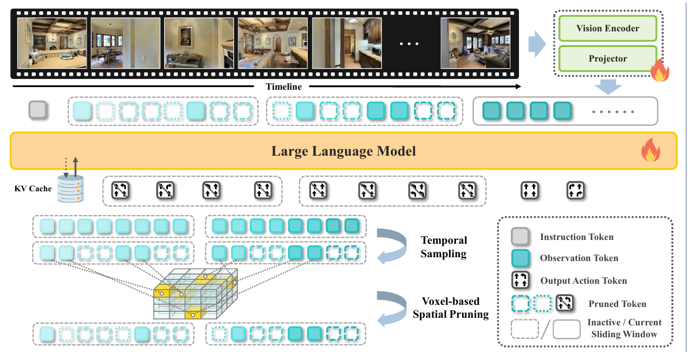

# StreamVLN

> 完整英文标题：StreamVLN: Streaming Vision-and-Language Navigation via SlowFast Context Modeling
>
> 作者：Meng Wei、Chenyang Wan、Xiqian Yu、Tai Wang（同等贡献）、Yuqiang Yang、Xiaohan Mao、Chenming Zhu、Wenzhe Cai、Hanqing Wang、Yilun Chen、Xihui Liu、Jiangmiao Pang。
>
> 发表出处与时间：ICRA 2026，2026 年 6 月。笔记依据提供的 8 页 arXiv:2507.05240v2，2025-07-07 首发，2026-07-09 修订。
>
> 原文与代码：[arXiv v2](https://arxiv.org/abs/2507.05240v2) · [项目主页](https://streamvln.github.io/) · [官方实现](https://github.com/InternRobotics/StreamVLN)
>
> 阅读日期：2026-11-15
>
> 阅读深度：精读（正文、算法与主要图表，未复现）
>
> 主题标签：视觉语言导航、VLN-CE、流式推理、KV 缓存、视觉 Token 剪枝、DAgger

## 一句话总结

StreamVLN 将指令跟随建模为图像与动作交替的多轮对话，窗口内复用 KV 缓存，窗口间保留压缩后的视觉记忆。使用额外导航数据的纯 RGB 版本在 R2R-CE 和 RxR-CE 未见验证集分别达到 56.4% 和 54.4% 成功率，Go2 实机在远端 RTX 4090 上平均约 0.27 秒生成 4 个动作。

## 问题与背景

语言指令会引用早先经过的地标，机器人又需要根据最新画面及时转向或停止。每轮重新编码历史会重复计算。把所有历史保留在 KV 缓存里，存储开销会随交互增长。只稀疏抽帧也可能跳过短暂可见的线索。论文按信息的时效安排两种更新频率，让近期观测保持细节，把更早的观测压缩成有限记忆。

## 核心方法

图源为原论文 Figure 2（PDF 第 2 页）。

### 快上下文：滑动窗口内复用 KV

以 LLaVA-Video 7B（语言主干 Qwen2-7B）为基础，将任务指令和连续 RGB 观测送进模型。每轮追加新观测，基于指令、记忆和近期对话逐 Token 解码动作，历史动作也作为当前窗口的上下文。窗口内已有 Token 的 Key 和 Value 可以直接用于后续注意力计算，减少重复 prefill。

默认窗口容纳 **8 轮对话**。切窗后，旧窗口中的提示与生成动作不进入长期记忆，视觉状态经压缩后供下一窗口使用。新窗口首轮需要为历史上下文做 prefill，因此延迟会在切窗时短暂上升。

### 慢上下文：时间采样与 3D 体素剪枝

先从历史选取固定数量的帧，默认记忆预算为 **8 × 196** 个视觉 Token（剪枝前）。可选的空间剪枝用深度和位姿把图像 patch 反投影到共享 3D 坐标，再离散成体素。Algorithm 1 将时间按步幅 K 分块，在每个时间块中对投到同一体素的 Token 只保留最新一帧的代表。若某帧保留的 Token 数低于阈值，则整帧去掉。掩码直接选择要保留的 Token 状态，剪枝无需额外训练。

**传感器口径**：基础策略用单目 RGB 视觉输入。Table I 中两种剪枝变体另外用深度和里程计做反投影。Prune-Mem 只剪长期记忆，Prune-All 同时剪记忆和流式帧的 KV 缓存。

### 两阶段多源训练

先用专家导航轨迹微调 1 个 epoch，再让模型在 Habitat rollout，由最短路专家标注纠偏动作（DAgger），将纠偏样本、专家轨迹和通用视觉语言数据混合训练 1 个 epoch。导航数据来自 R2R、R2R-EnvDrop、RxR 和 ScaleVLN，纠偏数据约 24 万剪辑。通用数据约 24.8 万问答样本（LLaVA-Video-178K、ScanQA）及 23 万 MMC4 交错图文样本。论文报告全部训练约 1,500 A100 GPU 小时。

ScaleVLN 用量在 v2 不同段落中分别写作 30 万训练样本和 15 万子集，项目页又将含 ScaleVLN 的专家数据合计写为 45 万剪辑。复现时需核对轨迹与切窗后样本的计数口径。

## 实验与证据

### 仿真主结果

在 Habitat / Matterport3D 的 R2R-CE、RxR-CE Val-Unseen 上比较。R2R-CE 路线平均约 10 米，RxR-CE 约 15 米，含英语、印地语、泰卢固语指令。SR 是停止后成功比例，SPL 按路径效率加权，OS 衡量途中曾到达成功范围的比例，NE 是终点误差，nDTW 衡量与参考轨迹的对齐程度。

| 方法（Table I 摘录） | R2R SR / SPL | RxR SR / SPL | 观测说明 |
| --- | --- | --- | --- |
| ETPNav | 57.0 / 49.0 | 54.7 / 44.8 | 全景、里程计、深度，使用路点预测器 |
| NaVILA | 49.7 / 45.5 | — | 单目 RGB |
| StreamVLN | 52.8 / 47.2 | 48.6 / 42.5 | 单目 RGB |
| NaVILA† | 54.0 / 49.0 | 49.3 / 44.0 | 单目 RGB |
| StreamVLN† | 56.4 / 50.2 | 54.4 / 45.4 | 单目 RGB |
| StreamVLN-Prune-Mem† | 57.4 / 51.1 | 53.9 / 45.1 | 深度、里程计辅助剪枝 |
| StreamVLN-Prune-All† | 56.0 / 48.5 | 53.3 / 44.0 | 深度、里程计辅助剪枝 |

† 表示使用额外 VLN 数据。纯 RGB 且使用额外数据时，相对 NaVILA†，R2R SR 高 2.4 个百分点，RxR SR 高 5.1 个百分点。ETPNav 的 RxR SR 仍略高于 StreamVLN†，后者 SPL 和 nDTW 较高。§IV-C 叙述中的 56.9/51.9、52.9/46.0 与同版 Table I 不一致，此处按表中各设置记录。

### 剪枝、缓存与训练消融

- **剪枝**：Prune-Mem 在 R2R / RxR 分别减少 28% / 22% 的记忆 Token，SR 变化 +1.0 / -0.5 个百分点。Prune-All 分别减少 32% / 30% 的视觉 Token，SPL 下降 1.7 / 1.4 个百分点。两组比例的分母分别为记忆 Token、视觉 Token。
- **记忆预算（Table IV）**：固定 8 轮窗口，记忆由 2 × 196 增至 8 × 196，R2R SR 从 37.3 升至 45.5，保留全部视觉历史时为 40.0。在同一 8 × 196 记忆预算下，窗口 4 / 2 / 8 轮对应 41.4 / 43.7 / 45.5 SR。结果来自仅用专家数据训练的消融。
- **缓存延迟（Figure 7）**：全轮缓存和 8 轮窗口在多数轮次都约 0.27 秒。切窗首轮升至约 0.48 秒，每轮重新 prefill 的曲线则在窗口内逐步上升。图中横轴覆盖约 24 轮，测的是生成 8 个动作 Token 的延迟。部署章节的 0.27 秒对应 4 个实际动作，两处各按原文口径记录。
- **数据（Table III，无剪枝）**：R2R SR / SPL 从专家数据的 45.6 / 42.3，增至加入 DAgger 与 VidQA 后的 50.8 / 45.7，再到混入 MMC4 的 52.8 / 47.2，加入 ScaleVLN 后达到 56.4 / 50.2。完整配方去掉 DAgger 后为 50.2 / 47.1。阶段对比同时改变了数据和训练过程，DAgger 去除实验提供了更直接的证据。百分点评估以表格原值为准。
- **视觉问答**：ScanQA 验证集使用 16 张多视角图像，精确匹配率为 28.8，NaVILA 为 27.4。论文以辨认《蒙娜丽莎》和爱因斯坦照片的导航例子展示可能的迁移，尚缺系统的问答能力与导航表现关联实验。

### 实机

Unitree Go2 搭载 RealSense D455，视觉数据传到 RTX 4090 工作站，返回可执行动作。平均推理约 **0.27 秒 / 4 个动作**，通信延迟约 **室内 0.2 秒、室外 1.0 秒**。实际闭环速度还取决于网络和动作执行时间。

Figure 5 针对每种方法每个场景做 20 次试验。StreamVLN 在走廊、单卧室、跨房间办公室的成功率为 **100%、85%、60%**，终点误差为 **0.2、0.3、0.5 米**。NaVILA 在同三场景的成功率为 100%、70%、0%。商场与室外结果来自定性展示。

## 我的理解与评价

窗口内复用缓存解决的是计算重复，窗口间的视觉压缩解决的是历史增长。两者对系统的影响可分别测量：前者看每轮 prefill 和峰值延迟，后者看显存、远距离地标回忆与终点停稳。论文最直接的证据来自窗口长度、缓存曲线和剪枝范围的消融。

体素去重隐含一个假设：同一空间位置较新的 patch 能代表过去看到的内容。位姿漂移、移动物体和视角变化都可能破坏这个假设；被剪掉的旧视角也可能恰好包含指令所指的地标。Prune-All 在 RxR 上的损失值得沿路径长度和地标再次出现的间隔进一步分析。实机结果覆盖三个定量场景，实际部署需要另测延迟分位数和更多地点的失败模式。

## 与其他论文的联系

| 工作 | 可比较的问题 |
| --- | --- |
| [OpenFly](../2026-openfly/index.md) | 两者都控制视觉历史的 Token 数。OpenFly 根据动作变化与指令地标挑关键帧，再合并特征。StreamVLN 保留窗口内交互并复用 KV，用深度和位姿去除跨帧空间重复。 |
| [AerialVLN](../2023-aerialvln/index.md) | 两者都要维持长程路线进度。AerialVLN 的 LAG 改善偏航时的监督，StreamVLN 使用 DAgger 在模型自己的轨迹上采集纠偏动作。 |
| [UrbanVLA](../2026-urbanvla/index.md) | 两者都有 Go2 实机系统与远端推理。UrbanVLA 把导航软件的结构化路点和转向提示转成局部轨迹，StreamVLN 根据自由语言指令生成低层动作。 |

主题入口：[连续环境视觉语言导航](../../topics/continuous-vision-language-navigation.md)。

## 后续行动

- [ ] 核对官方实现的切窗时序、历史采样规则、体素尺度、K 与整帧过滤阈值。
- [ ] 在同一分割复核 Table I，并记录记忆 Token、总视觉 Token、峰值显存和首轮及稳态延迟。
- [ ] 按路线长度和定位误差分组比较纯 RGB、Prune-Mem 和 Prune-All，定位地标丢失及误停止案例。

## 来源定位

§III-A–C、Figure 2 和 Algorithm 1 描述缓存与剪枝，§III-D 和 Figure 3 给出训练配方，Table I–IV 与 Figures 4–7 给出仿真、实机和消融。会议接收与版本日期据 arXiv v2 页面核对。
