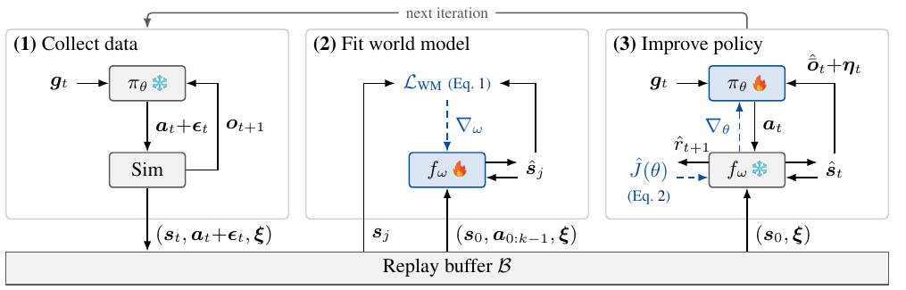

# SuperMimic

> 完整英文标题：SuperMimic: Scaling Humanoid Whole-Body Control with One Differentiable World Model
>
> 作者：Qiayuan Liao、Yiyang Shao、Junfeng Long、Kevin Zakka、Roberto Horowitz、Pieter Abbeel、Koushil Sreenath。Yiyang Shao 和 Junfeng Long 标注同等贡献，Pieter Abbeel 和 Koushil Sreenath 共同指导。作者来自 UC Berkeley。
>
> 发表出处与时间：CoRL 2026 口头报告，2026 年 11 月，美国得克萨斯州奥斯汀。本笔记依据提供的 19 页 arXiv:2610.28480v2。预印本于 2026-10-20 首发，v2 于 2026-11-09 修订（arXiv 日期）。
>
> 原文与项目：[arXiv v2](https://arxiv.org/abs/2610.28480v2) · [项目主页与实机视频](https://supermimic.github.io/) · [CoRL 2026](https://2026.corl.org/)
>
> 阅读日期：2026-11-15
>
> 阅读深度：精读（正文、主要图表及实验附录，未复现）
>
> 主题标签：人形机器人、全身控制、运动跟踪、可微世界模型、基于模型的强化学习、仿真到现实

## 一句话总结

SuperMimic 用一个可微世界模型学习同一台人形机器人在不同参考动作下共享的动力学，并在模型预测的短轨迹上直接对回报求梯度。单张 H100 训练 3 小时即可超过公开 SONIC 检查点在同一仿真基准上的归一化回报，所得控制器也能在 Unitree G1 实机上完成侧滚和翻转等动作。

## 问题与背景

全身运动跟踪给定一段参考动作，要求策略根据机器人状态输出关节动作，在接触、摩擦和重力作用下尽量复现参考轨迹。参考库从走跑扩展到舞蹈、侧滚和翻转时，无模型 RL 仍要靠大量仿真采样估计动作后果。SONIC 用大规模并行 PPO 训练单一通用策略，展示了覆盖大量动作的能力，同时需要约 21,000 GPU 小时。

论文的出发点是：参考目标在变，机器人的刚体和接触动力学可以共享。用一套学习到的动力学预测动作后果，可以复用不同动作和历史策略采集的转移数据。常规刚体仿真器负责提供训练转移，梯度由神经网络代理提供，因此可沿用 MuJoCo Warp 这样的仿真器。

## 核心方法

### 输入与输出

跟踪策略使用最近 **10 帧本体感知**和未来 **10 帧参考动作**。本体感知包括 29 个关节的位置、速度、IMU 角速度、机身坐标系中的重力方向和上一步动作。参考动作编码成 32 维潜变量，由共享解码器结合本体感知输出归一化关节设定值，交给低增益 PD 执行。部署时运行这个策略，世界模型用于训练。

### 三阶段训练循环



图源为原论文 Figure 2（PDF 第 4 页）。雪花表示当前阶段冻结参数，火焰表示更新参数。

1. **采集转移**。当前策略在 MuJoCo Warp 中执行加入高斯噪声的动作，将状态、实际执行的动作及每个 episode 的仿真上下文写入固定容量的 replay buffer。动作噪声扩展模型看到的动作范围。训练重置按一定比例混合均匀采样、低回报片段和历史困难片段。
2. **拟合世界模型**。从缓冲区取 `k = 8` 步窗口，以记录的起始状态和动作序列自回归预测。模型训练目标涵盖状态、奖励和无噪声观测的平方误差，以及终止概率的二元交叉熵。通过公式计算的输出项无需对应拟合损失。动力学 MLP 有三层、每层 2048 个隐藏单元，以摩擦、关节标定偏移和躯干质心偏移为上下文。已知传感器噪声在模型外采样。
3. **更新策略与 critic**。从 replay buffer 取起始状态，固定世界模型参数，用当前策略在模型里展开 `H = 32` 个控制步。每一步将传感器噪声加回预测观测，再交给策略。把短轨迹的折扣回报及末端 critic 估值沿时间反传（BPTT），利用动力学对状态和动作的导数更新策略。世界模型仍在每轮的拟合阶段更新。

### 策略目标与短窗口

设 `ĉ_t` 为到第 `t` 步的软存活权重，`d̂_{t+1}` 为下一状态的预测终止概率。原文式 (2) 的策略目标可写为：

```text
ĉ_0 = 1，ĉ_{t+1} = ĉ_t × (1 - d̂_{t+1})
Ĵ = E[Σ_{t=0}^{H-1} γ^t ĉ_t r̂_{t+1} + γ^H ĉ_H V(ŝ_H, g_H, ξ)]
```

软存活权重把越界终止转为可微的回报权重。critic 用想象轨迹上的 GAE 目标训练，补估短窗口以后的收益。默认控制频率 50 Hz，8 步拟合窗口约为 0.16 秒，32 步想象窗口约为 0.64 秒。该梯度对应学习到的代理模型，预测和梯度的偏差都可能影响更新方向。

## 实验与证据

### BONES-SEED 动作覆盖与训练成本

从已经重定向到 G1 的公开 BONES-SEED 运动库出发，按动作名称排除需要地形或道具的片段，再过滤穿地、悬空等不适合平地的轨迹。最终从 142,220 段保留 **129,514 段、264.56 小时**。归一化回报是整段未折扣奖励和除以其最大可能值，提前终止会降低分数。

| 检查点 | 训练硬件与时间 | GPU 小时（约） | 失败动作数 |
| --- | --- | --- | --- |
| SONIC 公开检查点 | 128 × L40，168 小时 | 21,504 | 179 |
| SuperMimic 单卡 | 1 × H100，3 小时 | 3 | 25 |
| SuperMimic 双卡 | 2 × H100，9.8 小时 | 19.6 | 0 |

Figure 3(a) 给出的 SONIC 回报为 **0.90**，单卡阶段在上述预算内超过它。约 56 倍的用时差和约 7,200 倍的 GPU 小时差来自两项运行的公开预算，单卡 3 小时计入完整训练循环，检查点评估单独计时。两者的 GPU 型号不同，SONIC 的训练动作约 611 小时，SuperMimic 用其公开子集。这个对照反映达到所报告回报所用的训练资源，算法差异应结合下面的受控实验判断。

**失败数衡量训练动作覆盖。** 附录 F 使用双方见过的筛选后训练库，每段从第一帧确定性运行一次，关闭域随机化和观测噪声，足底摩擦固定为 1.0。失败沿用 SuperMimic 的终止标准，根据根部高度和倾斜误差判定，同时各策略保留自己的执行器增益、动作尺度和输入构造。Table A.8 显示公开 SONIC 检查点的 44 段翻转全失败，单卡 SuperMimic 只失败 1 段。未见动作的泛化率仍待独立测试。

### 受控比较与机制消融

| 对照 | 原文结果 | 证据范围 |
| --- | --- | --- |
| LAFAN1 上的 PPO-Sim，Figure 4(a) | 40 段、2.45 小时动作上，SuperMimic 单卡 1.2 小时达到 0.82 检查点回报。PPO-Sim 在 18 小时预算内，1 / 4 / 8 卡分别最终达到 0.60 / 0.70 / 0.72。 | 匹配动作、观测、奖励、终止、域随机化和网络规模，PPO 使用 BeyondMimic 超参数，每卡并行环境数为 SuperMimic 的两倍。 |
| 动作库规模，Figure 3(b,c) | 数据为 1、7、40、264 小时，达到目标回报的 GPU 小时增长缓慢，8 步状态预测误差保持在 0.007–0.011。 | 误差按预设名义误差归一化，在策略 rollout 上在线测量，覆盖同一机器人和相同任务设定。 |
| Rollout 吞吐，Figure 5(a) | 实用批量（约 2k–16k 并行环境）下，世界模型每秒控制步数超过 MuJoCo Warp 的 10 倍，64k 时约 62 倍。 | H100 上的 rollout 吞吐，世界模型用 TF32，一个 50 Hz 控制步对应仿真器的四个 5 ms 子步。 |
| 同样使用世界模型的 PPO-WM，Figure 5(b) | 在 LAFAN1 走、跑和冲刺片段上，BPTT 策略以约 1/64 的想象步数达到 PPO-WM 的最佳训练回报。 | 横轴是想象步数，回报为训练回报。该消融针对策略更新方式。 |
| Critic 与预测长度，Figure 4(b,c)、§4.3 | 有 critic 时 `H = 16` 达到约 0.82，`H = 32` 达标最快。无 critic 时 `H = 16` 未达标。T-pose 受仿真速度推扰（0.5–4 m/s）后，有 critic 的策略在 0.5–2.4 秒恢复稳定，无 critic 的策略持续踉跄并在最大推扰下摔倒。 | 主结果与消融分别报告检查点回报和训练回报。后者的起点会随训练中的重置采样改变。 |

### 实机迁移与速度控制

- **实机（§4.4、Figure 6）**：同一个 G1 跟踪器无需逐动作调参，展示跳步、侧滚、90° 翻转和原地 360° 翻转。论文以四种动作的图像序列提供定性证据，规模化成功率仍来自仿真评估。
- **速度接口（§4.5、Figure 7、附录 G）**：为平面速度与偏航角速度命令训练独立编码器，复用动力学和动作解码器。RL 版本用速度跟踪奖励，蒸馏版本从参考动作读出命令并用参考跟踪奖励。672 个阶跃命令各试 4 次，RL 在 650 个命令上的误差更小，蒸馏在 15 个上更小，另有 7 个快速转向命令下蒸馏四试全摔。两者的中位相对稳态误差为 0.16 和 0.49。RL 版本还使用随机速度指令和参考潜变量对齐，两种策略各用一个训练种子，收益对应整套训练设置。速度任务的梯度只更新其编码器，解码器由动作跟踪任务更新。

## 我的理解与评价

最可复用的是把**共享的机器人动力学**与**各动作的跟踪目标**分开。吞吐实验量化了用网络替代刚体仿真 rollout 的收益，PPO-WM 对照单独检验了可微更新对想象样本用量的影响。推扰实验也说明，名义跟踪回报相近的策略仍可能具有不同的恢复能力。

有三个边界值得保留：

- **规模增长的证据针对一个机体与平地**。改变机器人形态、接触表面或道具时，动力学覆盖范围也会变。世界模型仅由仿真数据拟合。
- **评测条件影响模型的排名**。当前大规模评测使用训练库、单次确定性 rollout 和一套终止标准。还需要验证留出动作、不同摩擦与重复随机试验下的表现。正文称多个种子的训练稳定，图中未给出方差。
- **预测准确与梯度可靠需要分别检验**。稳定的 8 步状态误差支持在已测分布内复用模型，策略用到的是最长 32 步的回报梯度。极端接触和被推后状态尤其适合单独检查这两者。

## 与其他论文的联系

| 工作 | 与 SuperMimic 的关系 |
| --- | --- |
| SONIC | 同样大规模跟踪人类动作，使用仿真 PPO 训练通用策略。为比较训练资源和动作覆盖提供公开检查点。 |
| BeyondMimic | 提供跟踪任务、奖励和 PD 控制设定的基础。SuperMimic 增加未来参考帧，调整奖励和终止条件，并改用模型中的 BPTT。 |
| SuperTrack / SHAC | SuperTrack 用可微代理动力学优化跟踪，SHAC 用可微仿真与 critic 做短时域更新。SuperMimic 将两种思路结合到共享世界模型的训练循环。 |
| [UrbanVLA](../2026-urbanvla/index.md) | UrbanVLA 输出局部导航轨迹，由局部规划器执行。SuperMimic 跟踪参考动作，输出关节设定值。两者分别对应机器人从任务到轨迹、从参考动作到关节控制的不同层次。 |

主题入口：[人形机器人全身控制](../../topics/humanoid-whole-body-control.md)。

## 后续行动

- [ ] 核查公开代码与检查点，优先按附录 D/F 复核 LAFAN1 的 PPO-Sim 对照和 BONES-SEED 评估口径。
- [ ] 在统一硬件、训练动作和执行接口下比较 PPO-Sim、PPO-WM 和 BPTT，分别记录 GPU 小时、仿真步数和想象步数。
- [ ] 评估不同预测窗口的状态误差、梯度稳定性与推扰恢复，增加留出动作和跨摩擦测试。
- [ ] 在匹配速度命令分布、终止条件和训练种子的设置下复核速度任务，检验放开共享解码器更新的影响。

## 来源定位

§3、Figure 2 和附录 A–D 对应训练方法与超参数，§4.1–4.3、Figures 3–5 对应成本、吞吐和 critic 消融，附录 E/F 与 Table A.8 给出数据过滤和失败数口径，§4.4–4.5、Figures 6–7 及附录 G 给出实机与速度接口实验。会议和版本信息据论文首页、arXiv v2 和 CoRL 官网核对。
